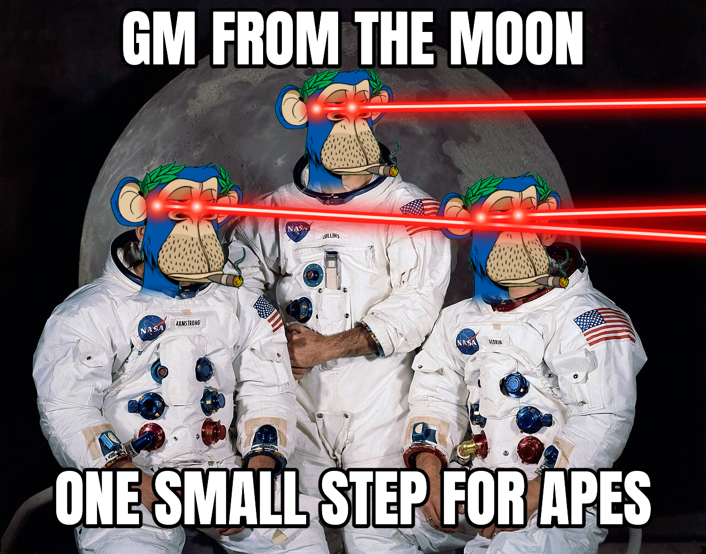

# Ape Face Booth

Upload a photo, pick a Bored Ape or Mutant Ape by number, and every face in the photo gets aped. Add laser eyes, filters and meme text, then download a PNG or GIF or post it to X.

**Live:** https://jeffreymt1.github.io/ape-face-booth/ · **Wiki:** https://bored-ape-yacht-club.fandom.com/wiki/Ape_Face_Booth



## How it works
- **Face finding** runs entirely in the browser with [face-api](https://github.com/vladmandic/face-api): an SSD MobileNet detector plus 68-point landmarks, so each ape tilts with the head. Photos are never uploaded anywhere.
- **Ape art** loads by number from each ape's official metadata on IPFS. `bayc-images.json` maps every Bored Ape (#0–9999) to its image CID; Mutants (#0–30006) come from `boredapeyachtclub.com/api/mutants/<id>`.
- **Background removal** flood-fills the ape's flat or gradient background from the edges, drops leftover specks, and fades the neck so only the head covers the face.
- **Sharing:** X's share links can't attach images, so "Post on X" copies the PNG to the clipboard and opens a pre-written post; paste the image with ⌘V or Ctrl+V. On phones and in Safari, "Share…" opens the native share sheet instead.

## Run locally
```bash
python3 -m http.server 8787
```
Then open http://localhost:8787. Copy image needs `localhost` or HTTPS.

## Files
- `index.html`, `styles.css`, `app.js`: the app (no build step)
- `bayc-images.json`: Bored Ape number → IPFS image CID
- `examples/`: an example output (PNG and GIF) and the QR code poster

Ape art © Yuga Labs. Fan-made; not affiliated with Yuga Labs. The sample photo is the Apollo 11 crew portrait by NASA (public domain).
